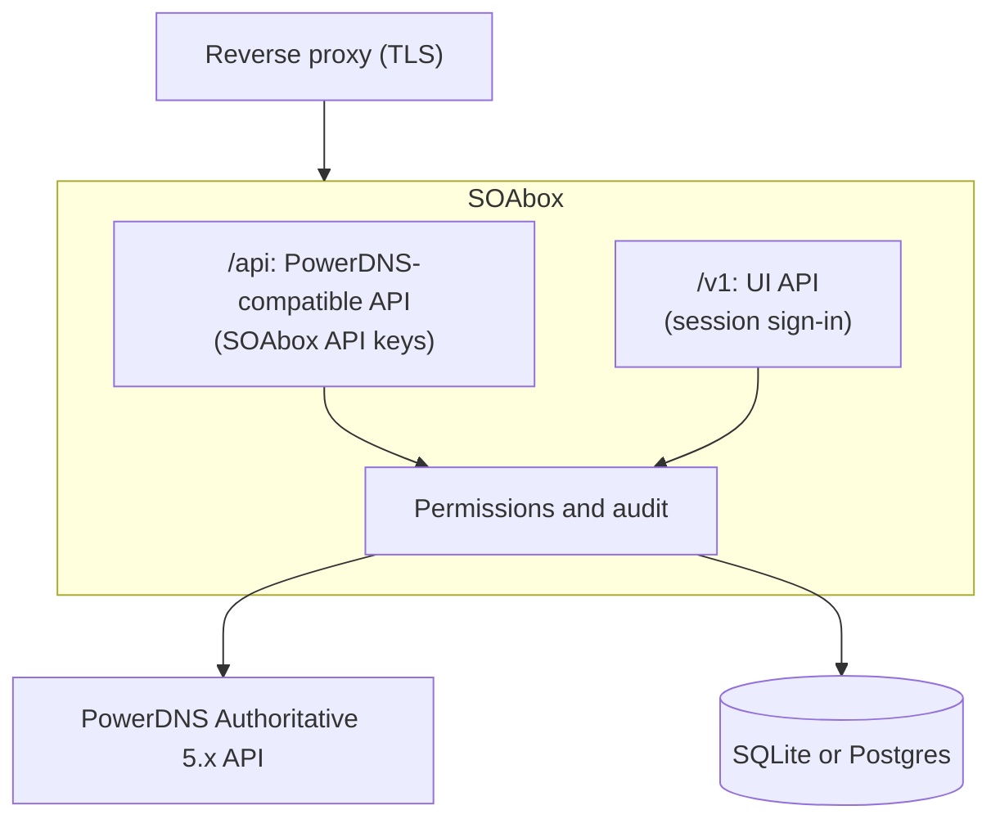

# SOAbox

SOAbox is a web interface and API gateway for [PowerDNS Authoritative Server](https://doc.powerdns.com/authoritative/) 5.x. It gives teams a clean UI for managing zones and records, and it gives automation a safer way to reach the PowerDNS API without changing a single line of client code.

## Why SOAbox

PowerDNS is an excellent DNS server, but managing it day to day leaves gaps:

- **The PowerDNS API has one key with full power.** Anyone or anything holding it can change every zone and the server configuration. There is no way to give a CI pipeline, a certificate tool, or a customer access to only the zones they own.
- **There is no record of who changed what.** The API does not keep an audit trail, so tracing a bad change back to a person or a tool is guesswork.
- **Existing web interfaces sit beside the API, not in front of it.** Tools like PowerDNS-Admin offer their own separate API, so automation either uses that non-standard API or bypasses the interface with the full-power PowerDNS key, and loses the permissions and history the interface provides.
- **Their user experience has not kept up.** Record editing is slow, permissions are coarse, and modern single sign-on is awkward to set up.

SOAbox closes those gaps by putting one permission and audit layer in front of PowerDNS, used by both the web interface and the API.

## The API: PowerDNS Compatible, With Guardrails

SOAbox serves the PowerDNS Authoritative 5.x HTTP API at the same paths, with the same request and response formats, status codes, and errors. A client cannot tell it is talking to SOAbox instead of PowerDNS. You point your existing tools at SOAbox and swap the API key.

What you gain:

- **Works with what you already run.** Terraform, external-dns, cert-manager and ACME DNS-01 hooks, octoDNS, and your own scripts keep working unchanged.
- **Scoped API keys.** Issue a key per tool, team, or customer, limited to specific zones or accounts. A scoped key only sees its own zones in listings, and any other zone looks like it does not exist.
- **Least privilege by role.** Admin keys reach everything. Operator keys manage all zones but not server settings. Scoped keys manage only what they are given, with optional permission to create new zones in their account.
- **Expiry and network limits.** Keys can expire and can be locked to source IP ranges.
- **A full audit trail.** Every change made through the API or the UI is recorded with who made it, from where, and a before and after view of each affected record set.
- **The real PowerDNS key stays private.** Only SOAbox holds it. Revoking a leaked key is a SOAbox change, not a PowerDNS restart and a fleet-wide key rotation.
- **One rule set for people and machines.** The UI uses the same permission and audit code as the API, so there is no side door.

## Features

- Zone management: create, delete, notify, AXFR retrieve, rectify, and export
- Record editor with validation and a review of pending changes before they are applied
- DNSSEC: enable, disable, manage keys, and view DS records
- Zone templates and zone metadata
- Users, accounts (groups of zones for a team or customer), and roles managed in SOAbox
- Sign-in with local accounts, OpenID Connect, or both. Microsoft Entra ID is documented and tested.
- Change history per zone and across the server
- Light and dark mode, keyboard accessible
- SQLite by default, Postgres supported
- Single container, designed to run behind a TLS-terminating reverse proxy

## Architecture



Built with Rust (Axum) on the backend and React on the frontend. Details are in the [design document](docs/spec/design.md).

## Quick Start

```sh
git clone https://github.com/invite-networks/soabox.git
cd soabox
cp .env.example .env    # set the keys and the bootstrap Admin password
docker compose up --build
```

Open http://localhost:8080 and sign in as the bootstrap Admin. See [getting started](docs/dev/getting-started.md) and the [install runbook](docs/runbooks/install.md).

## Documentation

- [Documentation index](docs/README.md): specifications, diagrams, decisions, developer docs, runbooks, and guides
- [Requirements](docs/spec/requirements.md) and [design](docs/spec/design.md)
- [API guide](docs/guides/api-guide.md): connecting tools to the PowerDNS-compatible API
- [Configuration](docs/dev/configuration.md)
- [Security policy](SECURITY.md)

## License

SOAbox is licensed under the [Apache License 2.0](LICENSE). Copyright SOAbox contributors.

PowerDNS is a trademark of PowerDNS.COM BV. SOAbox is an independent project and is not affiliated with or endorsed by PowerDNS.
