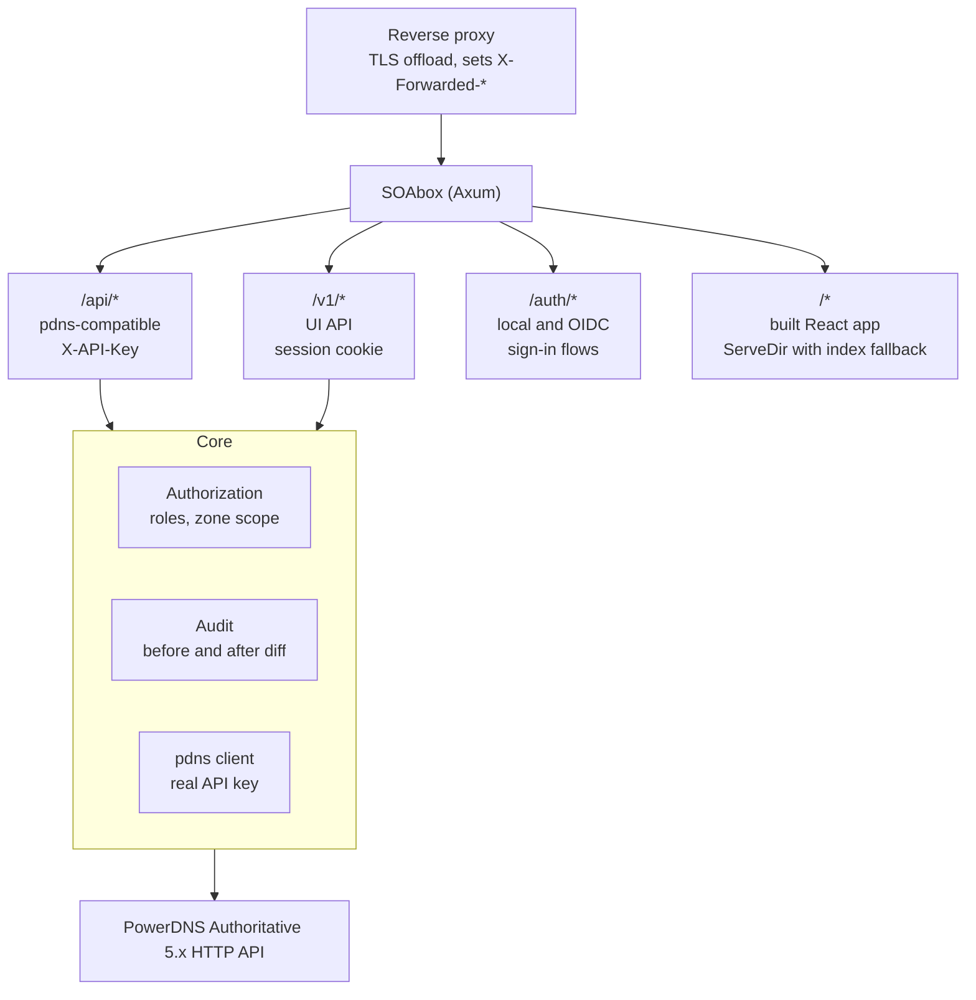

# SOAbox Design

Status: Draft, v0.x (rapid development)
License: [Apache-2.0](../LICENSE)

Back to the [README](../README.md). Implementation plans: [Milestone 1](plans/milestone-1-passthrough.md).

SOAbox is a web interface and API gateway for PowerDNS Authoritative Server 5.x. It replaces PowerDNS-Admin with a Rust backend and a React frontend. It has two jobs:

1. **A drop-in pdns API.** Any client written for the PowerDNS Authoritative 5.x HTTP API (Terraform, external-dns, cert-manager webhooks, octoDNS, scripts) can point at SOAbox instead of pdns and work unchanged. SOAbox adds per-key zone scoping and an audit trail that the client cannot see.
2. **A management UI.** Zones, records, DNSSEC, templates, users, accounts, roles, API keys, and history, with local or Entra ID (OIDC) sign-in.

## Goals And Non-Goals

Goals

- Indistinguishable from pdns 5.x to an API client: same paths, methods, request and response bodies, status codes, error shape, and relevant headers.
- One authorization and audit core shared by the passthrough and the UI. No path around it.
- Generic, unbranded UI suitable for a public project.
- Runs as a single container behind a TLS-terminating reverse proxy.

Non-goals (v0.x)

- Multiple pdns servers. One backend server, exposed as `server_id` `localhost`. The internal design keeps the server id as a parameter so more can be added later.
- PowerDNS Recursor.
- Importing data from PowerDNS-Admin.
- Entra bearer tokens on the API. The API accepts SOAbox-issued API keys only.

## Architecture



- `/api/...` is the passthrough. It mirrors the pdns path space exactly.
- `/v1/...` is the SOAbox API for the UI and for SOAbox-only features (users, accounts, roles, keys, settings, history). It is typed and published as OpenAPI through `utoipa`, and the frontend client is generated from it.
- Both route groups call the same core. Zone and record changes from the UI go through the same authorization and audit code as passthrough calls.
- The real pdns API key lives only in SOAbox configuration and is never returned to any client.

## API Passthrough

### Compatibility contract

- Paths: `/api`, `/api/v1`, `/api/v1/servers`, `/api/v1/servers/{server_id}` and everything below it (zones, rrsets via PATCH, notify, axfr-retrieve, export, rectify, cryptokeys, metadata, tsigkeys, autoprimaries, search-data, statistics, config, cache flush, views and networks).
- Bodies are forwarded byte-for-byte where possible. SOAbox parses only what it needs for authorization, filtering, and audit, and re-serializes only filtered list responses.
- Status codes and the `{"error": "..."}` body shape match pdns. Errors SOAbox produces itself (bad key, out-of-scope zone) use the same shape and the status pdns would use for the equivalent case.
- Response headers that clients may inspect (`Content-Type`, `Server`) are copied from the upstream response.
- Authentication uses the `X-API-Key` header, the same as pdns. Unknown or missing keys return `401` with pdns's body.
- A compatibility test suite runs every supported request against a real pdns 5 instance directly and through SOAbox, then compares status, headers of interest, and bodies.

### API keys

- Two separate kinds of key, always. Clients use SOAbox keys. SOAbox uses its own pdns key (`SOABOX_PDNS_API_KEY`) for every upstream call. A client's `X-API-Key` is never forwarded to pdns: it is checked by SOAbox and replaced with the pdns key on every request. A client that sends the pdns key itself is rejected like any other unknown key.
- Issued by SOAbox, stored as an argon2id hash with a short lookup prefix. The full key is shown once at creation.
- Each key has a role and a scope:
  - **Admin key**: full pdns API, including server-level endpoints (config, statistics, tsigkeys, autoprimaries, cache flush).
  - **Operator key**: all zones, no server configuration endpoints.
  - **Scoped key**: an explicit list of zones and/or accounts. Optional permission to create zones, which are assigned to the key's account automatically.
- Optional expiry, description, last-used timestamp, and a source IP allowlist (CIDR, checked against the trusted client IP).

### Scoping behavior

- List endpoints (`/zones`, `/search-data`) are filtered to zones in scope.
- Requests for a zone out of scope return the same `404` pdns returns for a missing zone, so scope cannot be probed.
- Endpoints not allowed for the key's role return `401` or `403`, matching what pdns returns for a key it rejects.
- Zone creation sets the pdns `account` field to the SOAbox account name, as PowerDNS-Admin does.

### Audit on writes

- For every write (POST, PUT, PATCH, DELETE) on a zone, SOAbox fetches the affected RRsets before the call, forwards it, and on success stores a history entry: actor (user or key), source IP, time, operation, zone, and the RRset diff.
- Failed writes are logged with the upstream status and error.
- Server-level writes (tsigkeys, autoprimaries, config) are audited with the request body, with secrets such as TSIG key material redacted.

## Authentication

Two sign-in methods. Roles and zone access are always managed in SOAbox, never taken from the identity provider.

- **Local accounts.** Username and password (argon2id). Optional TOTP. Admins can create local accounts for any role. The first Admin is created at first start from environment variables or the `soabox create-admin` CLI command.
- **Sign-in method setting.** When OIDC is configured, the Admin setting `local_login_with_oidc` controls whether local accounts may still sign in. Default is `allow`, so both methods work. When set to `deny`, only OIDC sign-in is offered, except for local Admin accounts, which can always sign in so there is an emergency login if the identity provider is unavailable. When OIDC is not configured, local sign-in is always on.
- **OIDC (Entra ID documented and tested).** Authorization code flow with PKCE, run by the backend. The browser never holds tokens. Users are matched by issuer and subject (`iss` + `oid` for Entra). On first sign-in a user is created with the default role from settings (User, with no zones) or blocked until an Admin approves the user, depending on a setting.
- Sessions are server-side rows. The cookie holds a random id that is hashed before storage, and is set with `HttpOnly`, `Secure`, and `SameSite=Lax`. A session is rotated on sign-in and on role change. Idle and absolute timeouts are configurable.
- CSRF protection on all state-changing `/v1` calls (double-submit token header).
- Login rate limiting per account and per client IP.

## Authorization Model

| Role | Zones | Records | DNSSEC | Templates | Users, accounts, keys, settings | Server config and stats |
|---|---|---|---|---|---|---|
| Admin | All | All | Yes | Manage | Manage | Yes |
| Operator | All | All | Yes | Manage | No | Read only |
| User | Assigned only | Assigned zones | Per setting | Use | Own API keys only, per setting | No |

- **Accounts** group zones and users (for example a customer or team). A User sees zones assigned directly to them plus all zones of their accounts.
- Settings mirror the useful PowerDNS-Admin toggles: users may create zones, users may delete zones, users may view history, users may manage DNSSEC, users may create their own API keys.
- Record type allowlists per zone kind (forward and reverse) are configurable.

## UI Features

- **Dashboard**: zone count, recent changes, server uptime and query stats (Admin and Operator).
- **Zones**: searchable, paginated list with kind, serial, DNSSEC status, and account. Create zone (Native, Primary, Secondary, with optional template and SOA-EDIT-API), delete zone, notify, AXFR retrieve, rectify, export as zone file.
- **Record editor**: RRset table with inline edit, add, delete, and disable. Validation per record type, TTL handling, and a pending-changes panel that shows the diff before applying as one PATCH. Optional automatic PTR creation in reverse zones the user can edit.
- **DNSSEC**: enable and disable, view keys and DS records, add, activate, deactivate, and remove keys.
- **Zone metadata**: view and edit allowed metadata kinds.
- **Templates**: named record sets applied when a zone is created.
- **History**: per-zone and global change log with diffs, filterable by user, key, zone, and date.
- **Administration**: users, accounts, roles, API keys, settings, and TSIG keys.
- **Server**: configuration and statistics (read only).

## Visual Design

The UI is unbranded. It uses a neutral, technical look with no company colors, logos, or fonts.

- Neutral slate gray scale for the canvas, surfaces, and text, plus one blue accent for primary actions, focus, and the active nav item. Semantic green, amber, and red for status, always paired with a text label or icon.
- Light and dark mode that follow the system setting, with a manual toggle.
- Inter for the interface and JetBrains Mono for record data, serials, and keys. Both are self-hosted, with no font CDN.
- Dense, table-first layout: a fixed left sidebar, a top bar with zone search and the user menu, and content in cards. Each destination appears once in navigation.
- Theme colors are CSS custom properties in one file, so operators can restyle SOAbox without rebuilding components.
- Accessibility: React Aria Components, keyboard-complete, visible focus, axe scans in end-to-end tests.

## Technology

Backend (Rust 2024 edition)

- `axum`, `tokio`, `tower-http` (tracing, security headers, compression, `ServeDir`)
- `reqwest` with `rustls` for the pdns client
- `sqlx` with SQLite (default) and Postgres support, migrations in `migrations/`
- `openidconnect` for OIDC, `argon2` for passwords and API key hashes, `totp-rs` for TOTP
- `utoipa` for the `/v1` OpenAPI spec, committed as `openapi.json` with a CI drift check
- `tracing`, `thiserror`, `anyhow`, `envy` and `dotenvy` for configuration

Frontend

- React 19, Vite, TypeScript (strict)
- TanStack Router, TanStack Query, TanStack Table
- React Aria Components wrapped in `src/components/ui/`
- Tailwind CSS 4, React Hook Form with Zod, `openapi-fetch` typed from `openapi.json`
- `lucide-react` icons
- Vitest, Testing Library, MSW, Playwright with axe

## Configuration

All configuration comes from environment variables with the `SOABOX_` prefix. A `.env.example` documents each one.

| Variable | Purpose |
|---|---|
| `SOABOX_PDNS_URL` | Base URL of the pdns API |
| `SOABOX_PDNS_API_KEY` | Real pdns API key |
| `SOABOX_PDNS_SERVER_ID` | Upstream server id (default `localhost`) |
| `SOABOX_DATABASE_URL` | `sqlite://...` or `postgres://...` |
| `SOABOX_BIND` | Listen address |
| `SOABOX_PUBLIC_URL` | External URL, used for OIDC redirects and cookies |
| `SOABOX_TRUSTED_PROXIES` | CIDRs allowed to set `X-Forwarded-*` |
| `SOABOX_OIDC_ISSUER`, `SOABOX_OIDC_CLIENT_ID`, `SOABOX_OIDC_CLIENT_SECRET` | OIDC provider (optional) |
| `SOABOX_SESSION_*` | Session timeouts |
| `SOABOX_BOOTSTRAP_ADMIN_*` | First Admin account |
| `SOABOX_STATIC_DIR` | Built frontend location |

## Reverse Proxy

- SOAbox assumes TLS is terminated by a reverse proxy.
- `X-Forwarded-For` and `X-Forwarded-Proto` are honored only from `SOABOX_TRUSTED_PROXIES`. The resolved client IP is used in logs, audit entries, rate limits, and API key IP allowlists.
- Cookies are always `Secure`. HSTS is left to the proxy, but SOAbox can set it if configured.

## Deployment

- One container image: the Rust binary plus the built frontend.
- `compose.yaml` for development and testing starts SOAbox and PowerDNS Authoritative 5 (SQLite backend) with bind-mounted volumes.
- Example Compose file for production with Postgres.
- Kubernetes manifests later, if wanted.

## Repository Layout

```
soabox/
  backend/            Rust crate (lib + bin), migrations/, openapi.json
  frontend/           React app
  deploy/             compose.yaml, example configs
  docs/               design, configuration, Entra setup guide
  tests/compat/       pdns compatibility suite
  LICENSE             Apache-2.0
```

## Milestones

1. **Passthrough core**: config, pdns client, API keys, scoping, audit, compatibility suite.
2. **Auth**: local accounts, sessions, OIDC with an Entra setup guide.
3. **UI foundation**: shell, theme, component layer, zone list, record editor.
4. **Administration**: users, accounts, roles, keys, settings, templates, history.
5. **DNSSEC, metadata, TSIG, server views.**
6. **Hardening**: security audit, dependency audit, end-to-end and accessibility tests, release image.

## Project

- Repository: `github.com/invite-networks/soabox` (public)
- Copyright: "SOAbox contributors"
