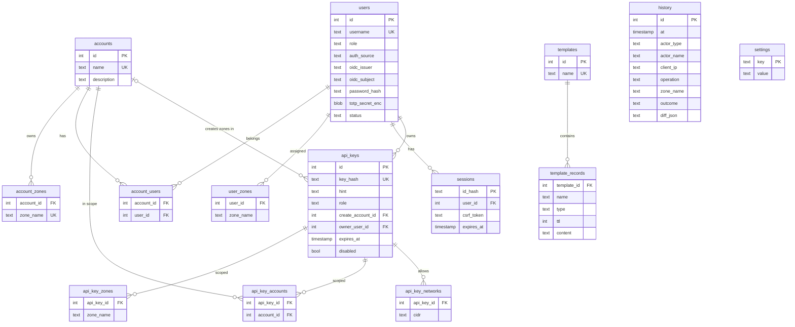

# Data Model

Supports [design section 4](../spec/design.md#4-data-model).

`history` and `settings` have no foreign keys on purpose. History must survive deletion of the actor or zone it describes.
