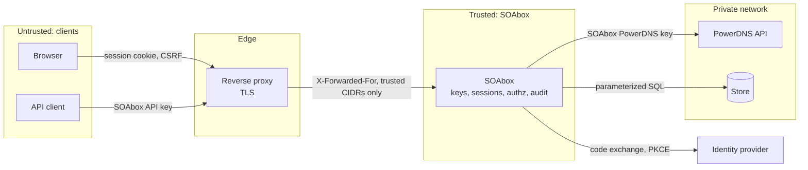

# Data Flow And Trust Boundaries

Supports [design section 7](../spec/design.md#7-security-boundaries).

Data that never crosses outward: the PowerDNS key, password hashes, key digests, TOTP secrets, and session ids.
